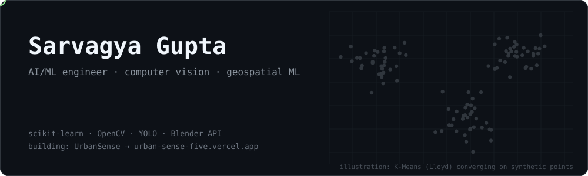

### AI/ML engineer in training. Computer vision and applied ML.

I turn raw data into models that make decisions.
Clean features, honest evaluation, working demos.

## What I build
- Spatial ML pipelines: scraping, feature engineering, clustering, dashboards.
- Computer vision with OpenCV and YOLO.
- 3D scene scripting with the Blender Python API.

## Featured projects
| Project | What it does | Stack | Link |
|---|---|---|---|
| **UrbanSense** | Livability index for 10,328 Indian neighbourhoods across 9 cities. | OSM, haversine BallTree, Copernicus AQI, K-Means, Next.js, Mapbox | [Live](https://urban-sense-five.vercel.app) / [Repo](https://github.com/Obister-ji/UrbanSense) |
| **MLproject_heart** | Heart disease prediction, built from scratch in a Jupyter notebook. Models: [TODO]. Accuracy: [TODO]. | Python, pandas, scikit-learn | [Repo](https://github.com/Obister-ji/MLproject_heart) |
| **[TODO: Project 3]** | [TODO: one-line result. State exactly what I built.] | [TODO] | [TODO] |

## Stack

## Contact
[LinkedIn](https://linkedin.com/in/sarvagya-gupta-705a19365) / [sarvaxgupta@gmail.com](mailto:sarvaxgupta@gmail.com)

